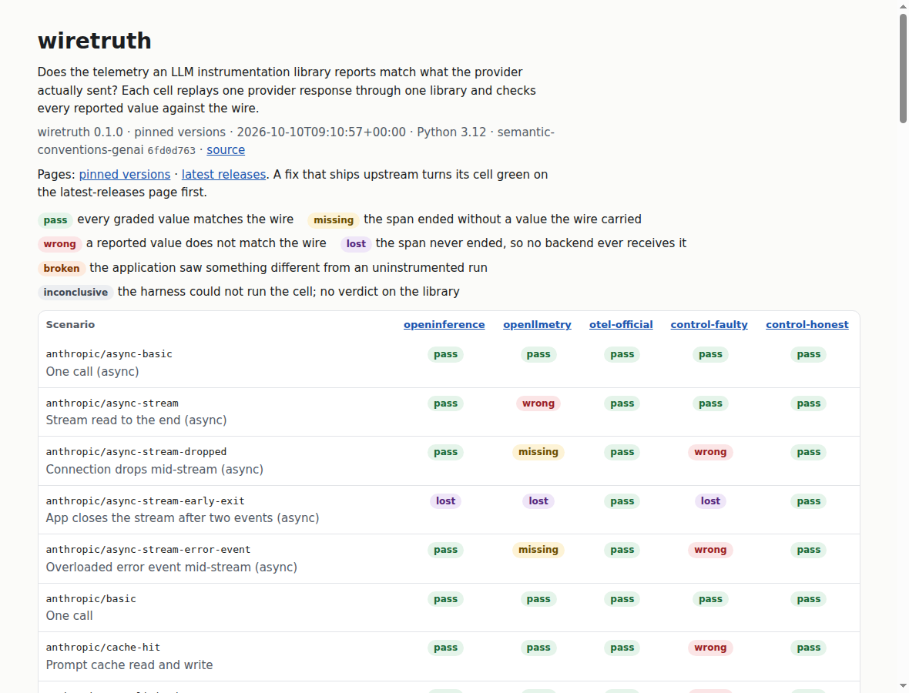

# spantruth

**Does your LLM telemetry tell the truth?** spantruth replays provider responses through LLM
instrumentation libraries and checks the values they report against what the provider actually
sent: tokens, cache tokens, models, finish reasons, errors, and whether the span ends at all.

Your cost dashboard reads those numbers. Find out what your versions get wrong, with no API key and
no setup. Run this in your project:

```sh
uvx spantruth doctor
```

Without [uv](https://docs.astral.sh/uv/), [run it in a container](https://github.com/Plexito-de/spantruth/blob/main/docs/for-app-engineers.md#run-it-in-a-container).


<details>
<summary>The start of the output, as text</summary>

```text
OpenLLMetry  (anthropic 2.4.0, openai 3.42.1, opentelemetry-instrumentation-anthropic 0.62.4, ...)
  ST01 Ghost span: 5 of 45 scenarios
    The app made the call, and no finished span ever reaches a backend.
    Cost figure for one call: -100%, at list price
    For example, anthropic/stream-early-exit: never ended: anthropic.chat
    Tracked at https://github.com/traceloop/openllmetry/issues/4536
    Tracked at https://github.com/traceloop/openllmetry/issues/4643
  ST02 Double span: 14 of 45 scenarios
    One call reports its token usage on two spans.
    Cost figure for one call: +100% in a backend that sums across spans, at list price
    Today: Let one side report the call: set ANTHROPIC_OPEN_TELEMETRY=false, or pass open_telemetry=False to the client.
  ...
```

</details>

[](https://github.com/Plexito-de/spantruth/actions/workflows/ci.yml)
[](https://plexito-de.github.io/spantruth/)
[](LICENSE)


**[Read the report](https://plexito-de.github.io/spantruth/)**: every library, every scenario,
every finding with the rule it applies. It is rebuilt every night, at pinned versions and at the
latest releases.

[](https://plexito-de.github.io/spantruth/)

## What it found

Pinned versions, 2026-11-03: openai 3.42.1 and anthropic 2.4.0 under every library. Each finding
is reported upstream, by the people credited below, and the nightly run against the latest
releases shows when a fix lands.

| Library | Finding | Upstream |
| --- | --- | --- |
| OpenLLMetry | Anthropic streams overcount output tokens. `message_delta` carries the cumulative count, and the wrapper adds it to the count in `message_start` (`1` in the scenarios). | [#4377](https://github.com/traceloop/openllmetry/pull/4377), by @arthi-arumugam-git |
| OpenLLMetry | A sync Anthropic stream that fails mid-way (a dropped connection, an `overloaded_error` event) never ends its span. The async stream ends it with status `ERROR`, but without `error.type`. | [#4643](https://github.com/traceloop/openllmetry/issues/4643), by @chrikrah |
| OpenLLMetry | An OpenAI stream that fails mid-way ends its span with status `OK`, sync and async. | [#4535](https://github.com/traceloop/openllmetry/pull/4535), by @feiiiiii5 |
| OpenLLMetry | An Anthropic stream the app closes early never ends its span. | [#4536](https://github.com/traceloop/openllmetry/issues/4536), by @armanunix |
| OpenInference | 44 of 45 scenarios pass. An async OpenAI stream read through `with_streaming_response` ends its span without the response model, the finish reason and the token counts. The early-exit spans that never ended are fixed in `openinference-instrumentation-openai` 0.1.66 and `openinference-instrumentation-anthropic` 3.1.0. | [#1134](https://github.com/Arize-ai/openinference/issues/1134), by @SiyuanQi; [#3790](https://github.com/Arize-ai/openinference/issues/3790), by @feiiiiii5; [#3930](https://github.com/Arize-ai/openinference/issues/3930), by @armanunix |
| OpenTelemetry GenAI instrumentation | Every scenario passes. | |
| Anthropic SDK, built-in tracing | The SDK's own spans get the tokens, the cache counts and the errors right, but record the stop reason as `anthropic.message.stop_reason`, so `gen_ai.response.finish_reasons` is missing. | [#2055](https://github.com/anthropics/anthropic-sdk-python/issues/2055), by @chrikrah |
| A library on top of anthropic 1.14.0 or later | The SDK creates its own span for every call when a global tracer provider is registered, so a library on top reports each call on two spans, and a backend that sums token counts counts them twice. `otel-official-sdk-on` shows it: 14 of 19 cells. OpenLLMetry 0.62.4 does the same. OpenInference handles it since `openinference-instrumentation-anthropic` 3.1.1. spantruth turns the SDK's spans off for the other library subjects (`ANTHROPIC_OPEN_TELEMETRY=false`). | [opentelemetry-python-genai#971](https://github.com/open-telemetry/opentelemetry-python-genai/issues/971), by @lmolkova; [langfuse#18978](https://github.com/langfuse/langfuse/issues/18978), by @rvndbalaji; fixed in [openinference#4121](https://github.com/Arize-ai/openinference/pull/4121), by @PabloPardoGarcia |

Every finding belongs to one of [ten named bug classes](https://plexito-de.github.io/spantruth/bugs.html),
such as a ghost span (the span never ends, so the call disappears), a double span (usage on two spans), or
phantom tokens. Where a count is wrong, the report also shows what that does to a cost figure at list
price. The run behind the table is committed as
[`results/2026-11-03-pinned.json`](results/2026-11-03-pinned.json).

## Where to go next

- **You use an instrumentation library in an application.**
  [For application engineers](https://github.com/Plexito-de/spantruth/blob/main/docs/for-app-engineers.md): run `doctor`, what each bug class costs, and
  how to fix it.
- **You maintain an instrumentation library.** [For maintainers](https://github.com/Plexito-de/spantruth/blob/main/docs/for-maintainers.md): test a
  checkout or a pull request with `--with`, gate CI with `--expect` and the GitHub Action, get a comment
  on each pull request, and show a badge.
- **You wrote your own wrapper around the OpenAI or Anthropic SDK.**
  [Test your wrapper in five minutes](https://github.com/Plexito-de/spantruth/blob/main/docs/test-your-wrapper.md).
- **You want a coding agent to check it.** In Claude Code, run
  `/plugin marketplace add Plexito-de/spantruth`, then `/plugin install spantruth@spantruth`. The
  [skill](https://github.com/Plexito-de/spantruth/blob/main/skills/spantruth/SKILL.md) runs `doctor` and reads its result.

[How it works](https://github.com/Plexito-de/spantruth/blob/main/docs/how-it-works.md) explains the fake provider, the checks, the two controls that
prove the suite, and the verdicts. It needs no API key. The first run downloads each library once,
and after that it needs no network.

## Coverage

OpenAI Chat Completions and Anthropic Messages, sync and async, and a first OpenAI Responses API
scenario: 45 scenarios in all, such as streams the app leaves early, dropped connections, 429s and
prompt-cache hits. [How it works](https://github.com/Plexito-de/spantruth/blob/main/docs/how-it-works.md#coverage) lists them.

The subjects are the [OpenTelemetry GenAI instrumentation](https://github.com/open-telemetry/opentelemetry-python-genai),
[OpenLLMetry](https://github.com/traceloop/openllmetry),
[OpenInference](https://github.com/Arize-ai/openinference),
[OpenLIT](https://github.com/openlit/openlit),
[Pydantic Logfire](https://github.com/pydantic/logfire),
[Langfuse](https://github.com/langfuse/langfuse-python), the
[Sentry SDK](https://github.com/getsentry/sentry-python),
[Datadog ddtrace](https://github.com/DataDog/dd-trace-py),
[MLflow Tracing](https://github.com/mlflow/mlflow), and the built-in tracing of the
[Anthropic SDK](https://github.com/anthropics/anthropic-sdk-python), plus the two controls.

Next, from the [plan](PLAN.md): the bug classes that repeat (tool calls and
reasoning tokens in a stream, the SDK helpers such as `messages.stream()`, the rest of the OpenAI
Responses API), Google Gemini, frameworks such as LiteLLM and Pydantic AI, and the JavaScript
libraries. [Help is welcome](CONTRIBUTING.md#ways-to-help).

## Related work

- [open-telemetry/semantic-conventions-conformance](https://github.com/open-telemetry/semantic-conventions-conformance)
  is the official project. It checks which attributes each instrumentation emits, against the
  semantic conventions, with Weaver. spantruth is complementary: it checks the values, and the
  failure paths. A finding that belongs upstream goes upstream.
- [spanproof](https://github.com/4ktLuffy/spanproof), by 4ktLuffy, applies the same method to
  Sentry's SDK integrations. spantruth takes its idea of validating every fixture with the
  provider SDK's own types from it.
- [wrong-numbers](https://github.com/arthi-arumugam-git/wrong-numbers), by arthi-arumugam-git, is a
  field guide to the same defect class across LLM eval, tracing and cost libraries: a number comes
  out wrong and nothing raises.
- [wiretruth](https://github.com/kartsan03/wiretruth), by kartsan03, checks what the provider SDK
  returns to the caller, from verbatim recorded responses. spantruth checks what the
  instrumentation writes on the span. This project was called wiretruth until 2026-10-12 and took
  its current name so the two stay easy to tell apart.

## Contributing

Contributions are welcome, and so are disputes. If you maintain one of these libraries and a cell
is unfair, [tell us](https://github.com/Plexito-de/spantruth/issues/new?template=dispute.yml): we
decide every dispute on whether the cited rule says what the check claims. To add a library, a
provider or a scenario, read [CONTRIBUTING.md](CONTRIBUTING.md). First-time contributors sign the
[Plexito CLA](https://github.com/Plexito-de/.github/blob/main/cla/INDIVIDUAL.md) with one comment
on their pull request.

## License

[Apache-2.0](LICENSE). Maintained by [Plexito](https://plexito.de).
