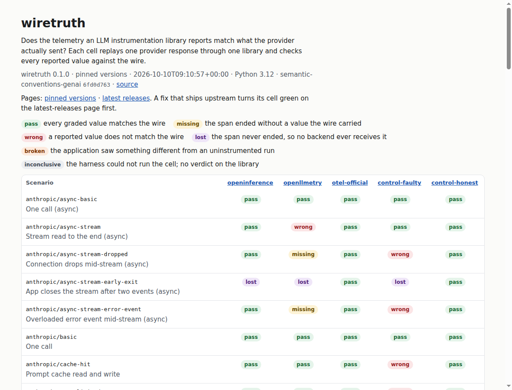

# spantruth

**Does your LLM telemetry tell the truth?** spantruth replays provider responses through LLM
instrumentation libraries and checks the values they report against what the provider actually
sent: tokens, cache tokens, models, finish reasons, errors, and whether the span ends at all.

Your cost dashboard reads those numbers. Find out what your versions get wrong, with no API key and
no setup. Run this in your project:

```sh
uvx spantruth doctor
```

```text
OpenLLMetry  (anthropic 2.4.0, openai 3.42.1, opentelemetry-instrumentation-anthropic 0.62.4, ...)
  ST01 Ghost span: 5 of 36 scenarios
    The app made the call, and no finished span ever reaches a backend.
    Cost figure for one call: -100%, at list price
    For example, anthropic/stream-early-exit: never ended: anthropic.chat
    Tracked at https://github.com/traceloop/openllmetry/issues/4536
  ST02 Double span: 11 of 36 scenarios
    One call reports its token usage on two spans.
    Cost figure for one call: +100% in a backend that sums across spans, at list price
    Today: Let one side report the call: set ANTHROPIC_OPEN_TELEMETRY=false, or pass open_telemetry=False to the client.
```

[](https://github.com/Plexito-de/spantruth/actions/workflows/ci.yml)
[](https://plexito-de.github.io/spantruth/)
[](LICENSE)


**[Read the report](https://plexito-de.github.io/spantruth/)**: every library, every scenario,
every finding with the rule it applies. It is rebuilt every night, at pinned versions and at the
latest releases.

[](https://plexito-de.github.io/spantruth/)

## Why

Cost dashboards, token budgets, alerts and audits all read the numbers that instrumentation
libraries put on spans. When a library adds a count twice or drops a cached token, nothing fails:
the dashboard shows a wrong number with full confidence. When a span never ends, the call is
missing from the trace altogether.

These bugs live on the paths that normal tests skip: a stream the app leaves early, a connection
that drops, a 429, a prompt-cache hit. spantruth tests exactly those paths, for every library,
in the same way.

## What the run shows

Pinned versions, 2026-11-03: openai 3.42.1 and anthropic 2.4.0 under every library. Each finding
is reported upstream, by the people credited below, and the nightly run against the latest
releases shows when a fix lands.

| Library | Finding | Upstream |
| --- | --- | --- |
| OpenLLMetry | Anthropic streams overcount output tokens. `message_delta` carries the cumulative count, and the wrapper adds it to the count in `message_start` (`1` in the scenarios). | [#4377](https://github.com/traceloop/openllmetry/pull/4377), by @arthi-arumugam-git |
| OpenLLMetry | A sync Anthropic stream that fails mid-way (a dropped connection, an `overloaded_error` event) never ends its span. The async stream ends it with status `ERROR`, but without `error.type`. | [#4643](https://github.com/traceloop/openllmetry/issues/4643), by @chrikrah |
| OpenLLMetry | An OpenAI stream that fails mid-way ends its span with status `OK`, sync and async. | [#4535](https://github.com/traceloop/openllmetry/pull/4535), by @feiiiiii5 |
| OpenLLMetry | An Anthropic stream the app closes early never ends its span. | [#4536](https://github.com/traceloop/openllmetry/issues/4536), by @armanunix |
| OpenInference | Every scenario passes. The early-exit spans that never ended are fixed in `openinference-instrumentation-openai` 0.1.66 and `openinference-instrumentation-anthropic` 3.1.0. | [#3790](https://github.com/Arize-ai/openinference/issues/3790), by @feiiiiii5; [#3930](https://github.com/Arize-ai/openinference/issues/3930), by @armanunix |
| OpenTelemetry GenAI instrumentation | Every scenario passes. | |
| Anthropic SDK, built-in tracing | The SDK's own spans get the tokens, the cache counts and the errors right, but record the stop reason as `anthropic.message.stop_reason`, so `gen_ai.response.finish_reasons` is missing. | [#2055](https://github.com/anthropics/anthropic-sdk-python/issues/2055), by @chrikrah |
| A library on top of anthropic 1.14.0 or later | The SDK creates its own span for every call when a global tracer provider is registered, so a library on top reports each call on two spans, and a backend that sums token counts counts them twice. `otel-official-sdk-on` shows it: 14 of 19 cells. OpenLLMetry 0.62.4 does the same. OpenInference handles it since `openinference-instrumentation-anthropic` 3.1.1. spantruth turns the SDK's spans off for the other library subjects (`ANTHROPIC_OPEN_TELEMETRY=false`). | [opentelemetry-python-genai#971](https://github.com/open-telemetry/opentelemetry-python-genai/issues/971), by @lmolkova; [langfuse#18978](https://github.com/langfuse/langfuse/issues/18978), by @rvndbalaji; fixed in [openinference#4121](https://github.com/Arize-ai/openinference/pull/4121), by @PabloPardoGarcia |

Every finding belongs to one of [ten named bug classes](https://plexito-de.github.io/spantruth/bugs.html),
such as a ghost span (the span never ends, so the call disappears), a double span (usage on two spans), or
phantom tokens. Where a count is wrong, the report also shows what that does to a cost figure at list
price.

Each finding on the report shows the expected value, the reported value, the attribute it was
read from, and the rule it applies, with a link wherever a spec states it. It also shows the spans
the library exported and the command that reproduces it, and it has its own link, so an upstream
issue can point at it.

## How it works

```text
spantruth run
  ├─ fake provider endpoint     serves the scenario: JSON, SSE stream, 429, dropped connection
  ├─ OTLP/HTTP receiver         collects every span the library exports
  └─ per library: own venv  →  the app calls the real OpenAI / Anthropic SDK
                                    └─ the library under test exports OTLP to the receiver
  checks: wire truth  ×  what the app saw  ×  what the telemetry says  →  verdict per cell
```

- **Values, not presence.** No two token counts in a fixture are equal. A swapped field,
  a dropped cache count, or a sum done twice shows up as a wrong number. For a wrong token count,
  the report names the arithmetic that most likely produced it, such as "cache reads and writes
  left out".
- **Fixtures follow the wire.** The test suite parses every response and every stream event with
  the provider SDK's own types.
- **Convention-neutral.** A value is read under the current OpenTelemetry GenAI names, older names,
  or OpenInference names. A library is never marked wrong for its choice of names.
- **The app is checked too.** Each scenario also runs without instrumentation. If the library
  changes what the app receives (an exception, a chunk, a return value, a hang), the cell is
  `broken`.
- **Spans that never end are found.** An in-process probe records every span start and end. A span
  that never ends is never exported, so the receiver alone could not tell.
- **Offline and deterministic.** No API keys, and no network after install.

## The controls

Two subjects run the suite's own small reference instrumentation. `control-honest` has to pass
every check. `control-faulty` carries four planted faults and has to fail exactly the checks
they target. CI runs both end to end on every change. If either moves, the suite is wrong, not a
library.

## Verdicts

| Verdict | Meaning |
| --- | --- |
| pass | Every graded value matches the wire. |
| missing | The span ended without a value that the wire carried. |
| wrong | A reported value does not match the wire. |
| lost | The span never ended, so no backend ever receives it. |
| broken | The app saw something different from an uninstrumented run. |
| inconclusive | The cell could not be graded: the harness could not run it, or the library's setup raised (`subject.instrument`). |

## Run it

You need [uv](https://docs.astral.sh/uv/). No clone, no API keys:

```sh
uvx spantruth doctor                                    # your project's versions, from its lock file
uvx spantruth list                                      # scenarios and subjects
uvx spantruth run --subject openllmetry                 # one library, every scenario
uvx spantruth run --out results.json                    # everything, about 3 minutes
uvx spantruth report results.json --html report.html
```

Each subject gets its own virtual environment under `~/.cache/spantruth/venvs`
(`$XDG_CACHE_HOME/spantruth` when that is set). A run writes nothing into the directory you run it
in: without `--out`, the results go to `~/.cache/spantruth/results/latest.json`. `--latest` unpins
the library's own packages. The run behind the table above is committed as
[`results/2026-11-03-pinned.json`](results/2026-11-03-pinned.json).

`doctor` reads `uv.lock`, `poetry.lock`, `pdm.lock`, `Pipfile.lock`, `requirements*.txt`, `.venv` or
`pyproject.toml`, in that order. It runs the libraries it recognizes at your versions, and it leaves the
Anthropic SDK's own tracing on, as your application does. It never runs your code, so it grades your
versions, not your application. `--json` prints a result for a script or a
[coding agent](skills/spantruth/SKILL.md). It exits 0 when it finds no problem, 1 when it finds one, 2 when
there is nothing to check, and 3 when it could not run something.

If you wrote your own wrapper, [test it in five minutes](docs/test-your-wrapper.md).

To work on spantruth itself, use a clone: `git clone https://github.com/Plexito-de/spantruth.git`,
then `uv sync` and `uv run spantruth list` in it.

### Test your own library, and a fix before it merges

`--with` replaces one package of a subject with a local checkout, a pull request's head, a
branch, or a version. A checkout is named by its `pyproject.toml`, and the results record what
each value resolved to.

```sh
uvx spantruth run --subject openllmetry --with ./packages/opentelemetry-instrumentation-anthropic
uvx spantruth run --subject openllmetry --with \
  "opentelemetry-instrumentation-anthropic @ git+https://github.com/traceloop/openllmetry@refs/pull/4377/head#subdirectory=packages/opentelemetry-instrumentation-anthropic"
```

A subject can live in your own repository. Copy the two files of a subject in
[`subjects/`](subjects/), `subject.toml` and `instrument.py`, into a directory and run it by its
path. A value with a slash is a path, and a value without one is a built-in subject:

```sh
uvx spantruth run --subject ./spantruth
```

### Fail CI on a regression, not on a known bug

Record the checks that your library fails today, commit the file, and compare every later run
with it:

```sh
uvx spantruth run --subject ./spantruth --write-expect spantruth-expected.toml
uvx spantruth run --subject ./spantruth --expect spantruth-expected.toml
```

| Exit code | Meaning |
| --- | --- |
| 0 | Every cell ran, and the failing checks equal the expectation file. |
| 1 | The failing checks differ from the file: a new failure, a fix, or a changed verdict. The output names each one. |
| 2 | Usage error, for example an unknown scenario in the expectation file. |
| 3 | spantruth could not build an environment or run a cell. This is not a verdict on the library. |

A fix fails the comparison too, so the file always says what the library fails today: record the
fix with `--write-expect`. `--summary "$GITHUB_STEP_SUMMARY"` adds the report to a GitHub Actions
job summary.

### Run it in GitHub Actions

```yaml
jobs:
  spantruth:
    runs-on: ubuntu-latest
    steps:
      - uses: actions/checkout@v5
      - uses: Plexito-de/spantruth@v0.4.0
        with:
          subject: ./spantruth                       # or a built-in subject, such as openllmetry
          with: ./packages/my-instrumentation        # your checkout, one per line
          expect: spantruth-expected.toml            # optional: fail only on a change
          comment: "true"                            # optional: one comment on each pull request
```

With `comment: "true"` and `pull-requests: write`, each pull request gets one comment that names the
checks that changed, and later runs update the same comment. A pull request from a fork has a read-only
token, so the step warns and the job goes on.

The step installs spantruth from its own ref, so a new release cannot change your results until
you move the tag. It writes the matrix, the findings and the differences to the job summary,
uploads the results and the HTML report as an artifact, and fails with the exit code of the run.
The `exit-code` output tells a difference (1) from an incomplete run (3). It runs on Linux and
macOS runners.

### Follow new releases

Every night spantruth runs the latest release of each library. When a new release changes a result, it
appears on [the changes page](https://plexito-de.github.io/spantruth/changes.html) and in
[the feed](https://plexito-de.github.io/spantruth/feed.xml).

### Show the result

The nightly run against the latest releases publishes a [shields.io](https://shields.io/badges/endpoint-badge)
endpoint per library, at `https://plexito-de.github.io/spantruth/badges/<subject>.json`:

```markdown
[](https://plexito-de.github.io/spantruth/latest.html)
```

## Coverage

- **Providers:** OpenAI Chat Completions and Anthropic Messages, sync and async. The OpenAI
  Responses API has its first scenario, a stream replayed from a recording.
- **Scenarios (32):** plain call, stream, stream without usage, prompt-cache hit (plain, streamed,
  and with cumulative counts in `message_delta`), parallel tool calls, reasoning tokens, HTTP 429,
  a stream the app leaves early (by `close()` and by a `with` block), a dropped connection, and
  Anthropic's mid-stream `error` event. Streams and failures run sync and async. A Responses API
  stream cut after eight recorded events replays kartsan03/wiretruth's
  `stream.missing-finish-abort` fixture, vendored unchanged with its provenance.
- **Subjects:** the [OpenTelemetry GenAI instrumentation](https://github.com/open-telemetry/opentelemetry-python-genai),
  [OpenLLMetry](https://github.com/traceloop/openllmetry),
  [OpenInference](https://github.com/Arize-ai/openinference),
  [OpenLIT](https://github.com/openlit/openlit), the
  [Sentry SDK](https://github.com/getsentry/sentry-python),
  [Datadog ddtrace](https://github.com/DataDog/dd-trace-py),
  [MLflow Tracing](https://github.com/mlflow/mlflow), and the built-in tracing of the
  [Anthropic SDK](https://github.com/anthropics/anthropic-sdk-python), plus the two controls. Sentry and
  ddtrace do not export OpenTelemetry spans, so a small local adapter copies their span data unchanged, and
  each subject's notes say what the adapter decides.

Next, from the [plan](PLAN.md): Logfire, the bug classes that repeat (tool calls and
reasoning tokens in a stream, the SDK helpers such as `messages.stream()`, the rest of the OpenAI
Responses API), Google Gemini, frameworks such as LiteLLM and Pydantic AI, and the JavaScript
libraries. [Help is welcome](CONTRIBUTING.md#ways-to-help).

## Related work

- [open-telemetry/semantic-conventions-conformance](https://github.com/open-telemetry/semantic-conventions-conformance)
  is the official project. It checks which attributes each instrumentation emits, against the
  semantic conventions, with Weaver. spantruth is complementary: it checks the values, and the
  failure paths. A finding that belongs upstream goes upstream.
- [spanproof](https://github.com/4ktLuffy/spanproof), by 4ktLuffy, applies the same method to
  Sentry's SDK integrations. spantruth takes its idea of validating every fixture with the
  provider SDK's own types from it.
- [wrong-numbers](https://github.com/arthi-arumugam-git/wrong-numbers), by arthi-arumugam-git, is a
  field guide to the same defect class across LLM eval, tracing and cost libraries: a number comes
  out wrong and nothing raises.
- [wiretruth](https://github.com/kartsan03/wiretruth), by kartsan03, checks what the provider SDK
  returns to the caller, from verbatim recorded responses. spantruth checks what the
  instrumentation writes on the span. This project was called wiretruth until 2026-10-12 and took
  its current name so the two stay easy to tell apart.

## Contributing

Contributions are welcome, and so are disputes. If you maintain one of these libraries and a cell
is unfair, [tell us](https://github.com/Plexito-de/spantruth/issues/new?template=dispute.yml): we
decide every dispute on whether the cited rule says what the check claims. To add a library, a
provider or a scenario, read [CONTRIBUTING.md](CONTRIBUTING.md). First-time contributors sign the
[Plexito CLA](https://github.com/Plexito-de/.github/blob/main/cla/INDIVIDUAL.md) with one comment
on their pull request.

## License

[Apache-2.0](LICENSE). Maintained by [Plexito](https://plexito.de).
